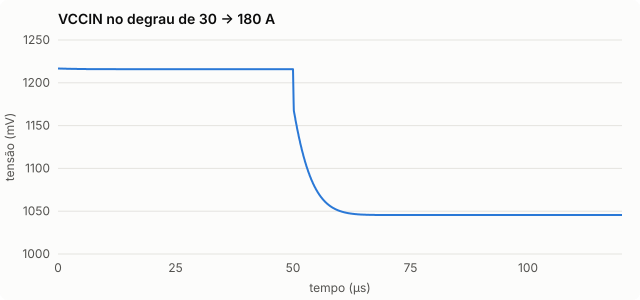
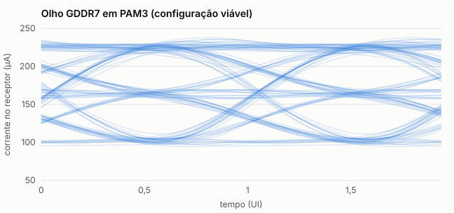
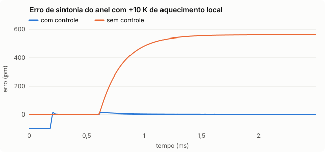

# Resultados da simulação

Gerado por `python3 -m modulos.sistema.simular`. Não edite à mão.

Conceito em [`conceito.md`](conceito.md). Visualizador 3D em [`../index.html`](../index.html).

## Etapa 1 e 2 — acoplamento e mapeamento

- 23717 células em contato, 0 em ponte, sondadas em 47 ms.
- **18 de 18 peças identificadas** só pelo padrão terra/energia/sinal. Erro máximo de posição 2,2 µm e 0,13°.
- Energizar antes da identificação é recusado: “nenhuma peça identificada ainda”.
- Trocar peças de lugar e girar qualquer peça em qualquer ângulo (37°, 63,5°, 133°, 301°) continua identificando certo (`tests/test_sistema.py`).

## Etapa 3 — energia

- Fonte de 12 V: 651 W (54,2 A); 327 W passam pela base, 323 W pelo cabo da GPU.
- VCCIN a 200 A em 376 pinos e 976 células: média 0,53 A por pino, máximo **0,88 A**; **0 pinos passam de 1 A**. Célula mais carregada: 0,38 A.
- Queda IR na base 22,3 mV, perdas 4,5 W.
- VRM, degrau 30 → 180 A: queda total 170 mV (reta de carga), assenta em 9,8 µs, desbalanço entre fases 9,1 %, eficiência 92,4 %.
- Curto numa célula: pico de 46 A, desarma em **151 ns**, 6,2 µJ na chave.

## Temperatura da base

A interconexão dissipa **118 W** dentro da própria base (chips tradutores e lasers). Só com o ar do gabinete a base chegaria a 255 °C. Com a placa fria sob a base (1000 W/m²K, líquido a 35 °C) e vias térmicas de cobre em 5% da área atravessando o LCP (troca efetiva 952 W/m²K), em carga máxima a base chega a **67 °C**. Sem as vias, o LCP de 1 mm segura o calor e a placa fria sozinha não basta.

- Aquecedor dos anéis: o local mais exigente pede 3,58 nm de sintonia; o aquecedor dá 4,00 nm. 0 chips sem faixa. A frio, os aquecedores gastam 19,1 W.
- Consumo da interconexão: **130 W**, 8,8 pJ/bit sobre 14,8 Tb/s; uma ligação elétrica inteira custa ~6,3 pJ/bit. Partes: tradutores 81,3 W, controle das células 0,0 W, lasers 29,6 W, aquecedores (pior caso) 19,1 W.

Nos tradutores ópticos:

| Peça | °C |
|---|---|
| CPU | 44,2 |
| DIMM0 | 35,2 |
| DIMM1 | 35,6 |
| FPGA | 37,6 |
| GPU | 53,0 |
| MEM0 | 46,0 |
| MEM1 | 51,2 |
| MEM2 | 50,5 |
| MEM3 | 45,1 |
| MEM4 | 49,4 |
| MEM5 | 45,6 |
| MEM6 | 46,0 |
| MEM7 | 48,3 |
| MEM8 | 44,7 |
| MEM9 | 45,5 |
| MEM10 | 50,9 |
| MEM11 | 49,3 |
| PCH | 36,8 |

## Etapa 4 — enlace óptico

| Configuração | Cálculo do documento | Modelo físico | BER |
|---|---|---|---|
| original | -6,06 dB | não fecha | 4,1e-01 |
| ajustada | +2,46 dB | não fecha | 2,5e-01 |
| viável | +8,48 dB | +1,27 dB | 1,3e-17 |

- **64 comprimentos de onda por fibra não fecham.** Com anel de raio 5,0 µm o FSR é 13 nm; os canais ficam a 0,2 nm, menos que a largura do filtro. A soma do vazamento dos vizinhos fica do tamanho do sinal, e a BER trava num piso que mais potência não remove.
- **Configuração viável:** 16 λ por fibra a 1,16 nm (~203 GHz), anel de raio 3,5 µm (FSR 18,6 nm), 25 pm/V e 1 laser de 10 mW para cada 4 canais.

Varredura da configuração ajustada (margem em PAM3, dB):

| Raio | 8 λ | 16 λ | 32 λ | 64 λ |
|---|---|---|---|---|
| 5,0 µm | -4,60 | -5,21 | não fecha | não fecha |
| 3,5 µm | -4,54 | -4,75 | -6,94 | não fecha |
| 2,5 µm | -4,51 | -4,60 | -5,20 | não fecha |

Canais simulados no tempo (configuração viável):

| Sinal | BER | erros / bits | atraso eletro-óptico | olho |
|---|---|---|---|---|
| GDDR7 | 3,0e-14 | 0 / 5952 | 32 ps | 0,25 UI |
| PCIe5 | 4,9e-30 | 0 / 3968 | 25 ps | 0,44 UI |
| DDR5 | < 1e-30 | 0 / 3968 | 117 ps | 0,56 UI |

### Controle térmico dos anéis

- Sem controle o enlace aguenta **0,88 K** (NRZ) e **0,38 K** (PAM3) antes de perder a BER alvo.
- Com controle: trava em 200 µs; sob +10 K o erro máximo é 12,9 pm e o residual 0,05 pm. Sem controle chega a 561 pm.

## Conexões — a netlist do sistema inteiro

Cada sinal é seguido salto a salto: pino → célula → trilha na base → chip tradutor → modulador → fibra → filtro → receptor → driver de saída → trilha → célula → pino, com laser, alimentação, controle e relógio de cada bloco ativo. São 8871 blocos, 19184 ligações e 773 sinais. O verificador (`modulos/conexoes/verificador.py`) confere 12 regras.

Erros por regra, do conceito até o projeto atual:

| Regra | conceito: tradutor ao lado, célula com MOSFET | tradutor sob a peça | + relé MEMS na célula | + plano de energia com 2 oz | + placa fria sob a base | + vias térmicas até a placa |
|---|---|---|---|---|---|---|
| banda | 2656 | 2518 | 0 | 0 | 0 | 0 |
| energia | 1 | 1 | 1 | 0 | 0 | 0 |
| tempo | 46 | 0 | 0 | 0 | 0 | 0 |
| temperatura | 85 | 98 | 98 | 98 | 42 | 0 |
| **total** | **2788** | **2617** | **99** | **98** | **42** | **0** |

O que cada decisão resolveu:

- **banda** (conceito): cel:CPU:DDR5_A_A_DQ0: banda 0,1 GHz < 2,4 GHz de DDR5-DQ
- **energia** (conceito): CPU:VCCIN: 21 pinos acima de 1 A (máx. 1,21 A)
- **tempo** (conceito): GPU.G8_DQ16->MEM3.GX_DQ16 (ida): 1030 ps > 1000 ps
- **temperatura** (conceito): peça MEM7 (GDDR7): 151,5 °C > 105 °C

- **Tradutor sob a peça:** com o chip ao lado, trilhas de até 120 mm na base estouram o atraso e o desalinhamento da GDDR7; numa camada de fotônica debaixo da peça, cada pino desce poucos milímetros até o seu chip.
- **Relé MEMS na célula:** a célula do conceito usa a mesma chave para 1 A de energia e para sinal de 32 Gb/s. Uma chave de transistor com R_on baixo o bastante para a energia tem dezenas de pF desligada, e isso derruba a banda de todo sinal rápido. Um relé, quando aberto, é um vão de ar: 20 fF. Ele só pode mudar de estado sem corrente, e a configuração das células acontece antes de energizar.
- **Plano de energia com 2 oz:** com 1 oz a corrente se concentra nos pinos de VCCIN perto do VRM e alguns passam de 1 A.
- **Placa fria sob a base:** a interconexão dissipa dezenas de watts dentro da base; com o ar do gabinete, peças, células (relé até 85 °C) e anéis passam do limite, e o aquecedor não cobre a variação de temperatura.
- **Vias térmicas até a placa:** o LCP conduz mal (0,3 W/m·K); sem cobre atravessando a base, a placa fria rende só ~230 W/m²K e ainda sobram peças quentes demais.

Folga de cada número escolhido: [`sensibilidade.md`](sensibilidade.md). Contato imperfeito (peça inclinada, sujeira, pino torto): [`defeitos.md`](defeitos.md).

### Boot emulado na netlist: pronto em 490 ms

Máquina de estados com guarda em cada transição (`modulos/sistema/boot.py`):

| Etapa | Concluída em |
|---|---|
| Sondagem | 0,00 ms |
| Identificação | 47,43 ms |
| Configuração | 50,43 ms |
| Fonte e standby | 151,43 ms |
| ME do chipset | 181,53 ms |
| Trilhos principais | 182,63 ms |
| Tradutores e lasers | 183,13 ms |
| Anéis travados | 183,33 ms |
| Núcleo da CPU | 184,00 ms |
| Relógio e reset | 185,00 ms |
| BIOS pela DMI | 205,00 ms |
| Treino da memória | 405,00 ms |
| PCIe e GDDR7 | 490,33 ms |
| Pronto | 490,33 ms |

### O que o tradutor faz além de copiar

- **Decodificação parcial.** Os dados são copiados sem decodificar. O comando, não: para saber o sentido dos pinos bidirecionais e acompanhar os ajustes elétricos, o tradutor decodifica MRR, RD, WR, MRW:5,32,33,34,35 na DDR5 e RD, RDTR, WR, WRTR, MRS:3,7,8 na GDDR7, e copia sem ler o resto (ACT, NOP, PREab, PREpb, REFab, VREFCA). Leva 1,3 ns na DDR5 contra 15 ns até o primeiro dado, e 1,2 ns na GDDR7 contra 9 ns.
- **Ajustes dinâmicos da DDR5.** A CPU muda terminação e força de saída por MRW durante o uso. O tradutor de cada ponta espelha esses valores: com espelho, 0 de 10 comandos divergem; sem espelho, 8 de 10 (pior caso: programado 240 Ω, visto 40 Ω, -369 mV de amplitude).
- **PCIe 5.** A detecção de receptor é controlada pelo FPGA (o tradutor só apresenta terminação com a GPU identificada e a luz travada) e o ocioso elétrico atravessa a luz. A equalização escolhe o preset P8 com CTLE de 2 dB: olho com 0,82 de altura e 0,84 UI de largura; com um tradutor idealmente linear seria 0,82 e 0,84 UI — a não linearidade do anel quase não pesa em NRZ.

### Memória compartilhada

O conceito pede memória compartilhada mediada pelo FPGA via CXL. Nem a i5-13600KF nem a GPU suportam CXL, então isso não fecha com estas peças (aviso da regra R18). O que funciona hoje é a CPU enxergar a GDDR7 pelo PCIe com BAR redimensionável:

| Opção | Banda | Latência | Coerente |
|---|---|---|---|
| GPU vista pela CPU (ReBAR, PCIe 5 x16) | 55 GB/s | 1201 ns | não |
| DDR5 local (2 canais DDR5-4800) | 65 GB/s | 93 ns | sim |
| Unificada no encapsulamento (LPDDR5X-8533, 128 bits) (não dá nesta montagem) | 116 GB/s | 110 ns | sim |

## Etapa 5 — dados

- Canais ópticos: **755** em **64 fibras** com pinos bidirecionais comutados; 1287 em 103 fibras com um canal por sentido.

| Enlace | Atraso dos dados | Trilha elétrica na mesma posição | Placa-mãe comum |
|---|---|---|---|
| CPU-DIMM0 | 478 ps | 714 ps | 408 ps |
| CPU-DIMM1 | 654 ps | 952 ps | 408 ps |
| GPU-MEM7 | 226 ps | 340 ps | 102 ps |
| CPU-GPU | 337 ps | 544 ps | 1020 ps |
| CPU-PCH | 529 ps | 714 ps | 816 ps |
| CPU-FPGA | 1022 ps | 952 ps | 816 ps |

- Treino DDR5: DIMM0 converge (64 pistas, janela mínima 36 passos de 3,26 ps), DIMM1 converge.
- Mover o DIMM0 10 mm depois de treinado: **9 de 64 pistas** saem do olho. Por isso a reconfiguração vem antes do treino.
- Rajadas pelo canal simulado: DDR5 escrita sem erro, DDR5 leitura sem erro, GDDR7 escrita sem erro.

